<div align="center">
  
</div>
<br>

## 👨‍💻 Sobre mim

Tenho 18 anos e sou estudante de **Análise e Desenvolvimento de Sistemas na FIAP**. Meu foco é **back-end e dados**, mas também tenho uma boa base em front-end, o que me ajuda a entender a aplicação de ponta a ponta.

-  Busco ir além da teoria e transformar ideias em soluções reais
-  Estou sempre aprendendo novas tecnologias e boas práticas de desenvolvimento
-  Procuro minha **primeira oportunidade de estágio** em desenvolvimento ou dados, em São Paulo
- 📫 Contato: **gabriel.razodantas@gmail.com**

---

##  Tecnologias & Ferramentas

<div align="center">

**Back-end & Dados**


**Front-end**


**Ferramentas**


</div>

---

## 🏆 Principais Projetos

| Projeto | Descrição | Tecnologias |
|---|---|---|
|  **ÓrbitaAgro Copilot** | Assistente inteligente para o agronegócio, focado em otimizar processos, integrar dados do setor agrícola e apoiar a tomada de decisões. | Projeto FIAP |
|  **SoulUp (Smart Avatar)** | Startup idealizada para os desafios da FIAP, com foco em sustentabilidade e um assistente virtual interativo baseado em IA. | Projeto FIAP |
|  **Dashboard Automatizado** | Sistema que transforma planilhas do Excel (`.xlsx`) em gráficos interativos. | Python |
|  **Gestão Esportiva** | Estrutura lógica e banco de dados para um sistema de agendamento e gestão de escolinhas de futebol, com múltiplos níveis de acesso. | SQL · Modelagem |
|  **CRUD e Consumo de API** | Aplicações com operações de criação, leitura, atualização e exclusão de dados e consumo de uma API externa. | Java |

---

## 📈 Estatísticas

<div align="center">
  
  
</div>

---

## 📬 Vamos nos conectar?

<div align="center">
  <a href="https://www.linkedin.com/in/gabriel-razo-dantas-34724b301" target="_blank">
    
  </a>
  <a href="mailto:gabriel.razodantas@gmail.com" target="_blank">
    
  </a>
  <a href="https://www.instagram.com/gabrielrzd4" target="_blank">
    
  </a>
</div>

---

##  Área interativa

<details>
  <summary><b>☕ Clique aqui para conhecer meu código favorito</b></summary>
  <br>

```java
public class Gabriel {
    String curso = "Análise e Desenvolvimento de Sistemas - FIAP";
    String[] foco = {"Back-end", "Dados"};
    String[] stack = {"Java", "Python", "SQL", "TypeScript", "React"};
    boolean buscandoEstagio = true;

    public String status() {
        return buscandoEstagio
            ? "Pronto para colocar a mão na massa e somar com o time! 🚀"
            : "Codando...";
    }
}
```
</details>

<details>
  <summary><b>🧠 Desafio rápido: qual é o resultado desta query?</b></summary>
  <br>

```sql
SELECT COUNT(*) AS cafés_por_dia
FROM desenvolvedores
WHERE nome = 'Gabriel';
```

<details>
  <summary><b>👀 Ver resposta</b></summary>
  <br>
  <code>ERRO: valor muito alto para o tipo INTEGER</code> ☕😄
</details>
</details>

<details>
  <summary><b>🐍 Por que a cobrinha está aqui embaixo?</b></summary>
  <br>
  Ela "come" os quadradinhos do meu gráfico de contribuições. Quanto mais eu programo, mais comida ela tem!
</details>

<br>

<div align="center">
  <picture>
    <source media="(prefers-color-scheme: dark)" srcset="https://raw.githubusercontent.com/gabrielrazod9j-ops/gabrielrazod9j-ops/output/github-snake-dark.svg" />
    <source media="(prefers-color-scheme: light)" srcset="https://raw.githubusercontent.com/gabrielrazod9j-ops/gabrielrazod9j-ops/output/github-snake.svg" />
    
  </picture>

  <p><i>Construindo soluções e devorando desafios... 🐍</i></p>

  
</div>

<div>
  
</div>
